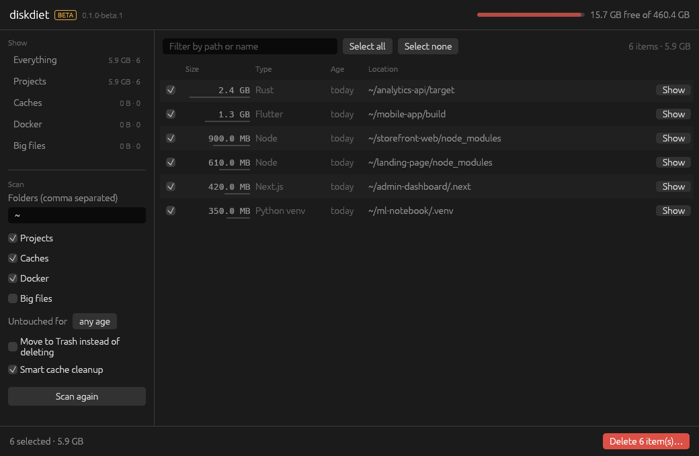

<p align="center">
  <picture>
    <source media="(prefers-color-scheme: dark)" srcset="docs/logo-dark.svg">
    
  </picture>
</p>

<h3 align="center">Put your storage on a diet.</h3>

<p align="center">
  You build fast with AI. Your storage fills up just as fast.<br>
  Disk Diet finds the <code>node_modules</code>, build folders, package caches and Docker leftovers eating your storage,<br>
  shows you what each one costs, and lets you pick what goes. CLI + a small native desktop app, written in Rust.
</p>

<p align="center">
  <a href="https://github.com/anggerari/diskdiet/actions/workflows/ci.yml"></a>
  <a href="https://github.com/anggerari/diskdiet/releases"></a>
  
  <a href="https://github.com/anggerari/homebrew-diskdiet"></a>
  
  <a href="LICENSE"></a>
</p>

<p align="center">
  <b>
    <a href="#install">Install</a> ·
    <a href="#why-diskdiet-exists">Why</a> ·
    <a href="#desktop-app">Desktop app</a> ·
    <a href="#cli">CLI</a> ·
    <a href="#what-it-finds">What it finds</a> ·
    <a href="#safety">Safety</a> ·
    <a href="https://github.com/anggerari/diskdiet/releases">Download</a>
  </b>
</p>

<p align="center">
  <picture>
    <source media="(prefers-color-scheme: light)" srcset="docs/screenshot-light.png">
    
  </picture>
</p>

> **Beta.** diskdiet works and is tested, but it is still young. Read the list before you delete, and report anything odd in [Issues](https://github.com/anggerari/diskdiet/issues).

## Why diskdiet exists

**You keep shipping with AI, and you forgot your storage is almost dead.**

AI coding tools made building ridiculously fast. An agent scaffolds a new app in minutes. Every task gets its own git worktree. Every worktree runs its own `npm install`. Every experiment pulls a fresh Docker image, every prototype builds a fresh `target/`, and then everyone moves on to the next idea.

The code gets reviewed. The leftovers never do.

A few weeks later your 256 GB or 512 GB laptop says *"Your disk is almost full"*. Builds slow down. Docker refuses to start. You end up digging through `~/Library` at midnight, trying to remember which of 40 `node_modules` folders still matter.

The fix is scattered across a dozen tools: `npm cache clean`, `docker system prune`, `cargo clean`, deleting Xcode's DerivedData by hand, `brew cleanup`… Each one cleans its own corner, and none of them shows you the whole picture.

**diskdiet puts it all on one screen:**

- **See**: one scan lists every project artifact, package-manager cache, Docker image, container and volume, and big forgotten file, sorted by size.
- **Choose**: you decide what goes. Nothing is deleted until you pick it and confirm, and projects with uncommitted work are flagged.
- **Stay lean**: an optional background job cleans projects you haven't touched in weeks and warns you before storage runs out.

Everything in the project and cache categories can be regenerated (`npm install`, `cargo build`, `docker pull`). You trade a few minutes of re-downloading for gigabytes back today.

## Install

**Prebuilt binaries** (macOS Apple Silicon / Intel, Linux x86_64):

```sh
curl -fsSL https://raw.githubusercontent.com/anggerari/diskdiet/main/install.sh | sh
```

This installs `diskdiet` (CLI) and `diskdiet-gui` (desktop app) into `~/.local/bin`. Each release also includes the **Disk Diet** app for macOS as a zip. The app is not notarized yet, so if you download it by hand, right-click it and choose **Open** the first time. The Homebrew cask handles this for you.

**Homebrew** (macOS and Linux):

```sh
brew install --cask anggerari/diskdiet/diskdiet    # macOS: "Disk Diet" app + the diskdiet command
brew install anggerari/diskdiet/diskdiet           # command line only (macOS and Linux)
```

Pick one. The cask puts **Disk Diet.app** in /Applications and links the `diskdiet` command onto your PATH, so you get both. The formula is for Linux, or if you only want the terminal tool. Installing both makes Homebrew stop with "already a binary at …/bin/diskdiet". To switch to the app, run `brew uninstall anggerari/diskdiet/diskdiet` first.

**From source** (Rust toolchain from [rustup.rs](https://rustup.rs)):

```sh
git clone https://github.com/anggerari/diskdiet && cd diskdiet
make install        # CLI only
make install-gui    # CLI + desktop app
make app            # macOS: build "dist/Disk Diet.app"
```

## Desktop app

The app is called **Disk Diet**. Open it from Applications, Spotlight or Launchpad, or from a terminal:

```sh
diskdiet-gui                 # open the app
diskdiet-gui --scan ~/code   # open and start scanning right away
```

It's a single native binary of a few megabytes, with no browser engine inside. It follows your system's light or dark theme.

- **Everything on one screen**, grouped into Projects, Caches, Docker and Big files, with collapsible groups and counts in the sidebar.
- **Folder tree in Projects**: projects grouped by the folders they live in, with totals per folder, collapsible, and checkboxes that select a whole folder. Switch to a flat **List** any time.
- **Filter pills** by ecosystem (Node, Rust, Flutter, Python…), **search** by name or path, and **sort** by size, name or last touched.
- **Every row tells you why**: ecosystem badge, project name, full path, and status pills such as `uncommitted`, `merged worktree`, `may hold data` or `smart prune`.
- **Storage card**: live free space, plus how much you'll have *after* cleanup as you select.
- **Clean everything selected**, or a single item from its row. Reveal anything in Finder first.
- **Stats** (all-time space freed, with history) and **Settings** (folders via the native picker, toggles, save as defaults).

| Shortcut | Action |
|---|---|
| `⌘F` | Search |
| `⌘R` | Rescan |
| `⌘A` | Select / unselect everything visible |
| `⌘⌫` | Clean up the selection |
| `⌘1` … `⌘7` | Switch views |
| `Esc` | Clear search / close dialog |

## CLI

```sh
diskdiet scan ~/code                    # read-only report
diskdiet clean ~/code                   # numbered picker: type "1 3 8" or "2-6"
diskdiet clean ~/code --tui             # full-screen picker: arrows + space
diskdiet clean ~ --older-than 30d       # only projects untouched for 30+ days
diskdiet clean ~/code --trash           # move to Trash instead of deleting
diskdiet big                            # big files in Downloads, Desktop, Documents, Movies
diskdiet docker                         # pick Docker images / containers / volumes
diskdiet docker --prune --docker-all    # bulk prune, like docker system prune -a
diskdiet stats                          # how much you've freed so far
diskdiet scan ~ --json | jq '.reclaimable'
```

```text
$ diskdiet clean ~/code

diskdiet clean  beta
21.4 GB free on disk. Found 84 item(s), ~58.3 GB reclaimable.

   #  sel  type          age        size  path
   1  [x]  Rust           3d      6.8 GB  ~/code/my-rust-api/target
   2  [x]  cache           -      5.1 GB  Go build cache · ~/Library/Caches/go-build
   3  [x]  Node          21d      2.4 GB  ~/code/old-landing-page/node_modules
   4  [ ]  Node           1d      1.1 GB  ~/code/shop/node_modules  ⚠ uncommitted changes
   5  [x]  Node           9d    730.0 MB  ~/code/shop-wt/fix-cart/node_modules  ✓ worktree 'fix-cart' already merged
   6  [x]  cache           -    640.0 MB  pnpm store · ~/Library/pnpm/store  smart: `pnpm store prune`
   7  [ ]  docker image   5w    980.0 MB  postgres:15 · unused
   8  [ ]  docker vol      -    415.0 MB  shop_db_data · unused, may hold data
  ...

  Selected: 61 item(s), ~41.7 GB

  Toggle by number (e.g. "1 3 8" or "2-6"), a = all, n = none, Enter = confirm, q = quit:
```

### Flags

| Flag | Meaning |
|---|---|
| `--older-than 30d` | Only projects untouched for at least this long (`s`, `m`, `h`, `d`, `w`) |
| `--min-size 100MB` | Hide anything smaller (default `1MB`) |
| `--no-projects` / `--no-caches` / `--no-docker` | Skip a category |
| `--big` | Also include big files |
| `--no-git` | Skip git checks (faster on huge trees) |
| `--trash` | Move to Trash instead of deleting permanently |
| `--tui` | Full-screen picker |
| `--wipe-caches` | Wipe caches even when a smarter prune command exists |
| `-y, --yes` | Delete without asking (only what is safe to delete automatically) |
| `--dry-run` | Show what `--yes` would delete |
| `--docker-all` | With `--yes`: also remove tagged images no container uses |
| `--docker-volumes` | With `--yes`: also remove unused volumes (⚠️ may contain database data) |

## What it finds

| Category | What |
|---|---|
| **Projects** | Node `node_modules` `.next` `.nuxt` `.output` `.svelte-kit` `.turbo` `.parcel-cache` `.angular` · Rust/Maven `target` · Gradle `build` `.gradle` · Flutter `build` `.dart_tool` · `Pods` · SwiftPM `.build` · Python `.venv` `venv` `__pycache__` `.pytest_cache` `.mypy_cache` `.ruff_cache` · Zig, Haskell, Elixir, Elm, Terraform · your own rules |
| **Caches** | npm, Yarn, pnpm, Bun, node-gyp, Cargo, pip, uv, Go, Gradle, Maven, Composer, Xcode DerivedData, device support, simulator caches, CocoaPods, Homebrew, Playwright, Puppeteer, Electron, JetBrains, Trash |
| **Docker** | Every image (real unique size, used or unused), stopped container, unused volume, build cache |
| **Big files** | Installers (`.dmg` `.pkg` `.iso`), archives, videos, VM disks, app builds, iOS backups, Xcode archives |

A project folder only counts when its build system file sits next to it. `target/` needs `Cargo.toml` or `pom.xml`, `build/` needs Gradle or Flutter files, and so on. A hand-made folder that happens to be called `build` is left alone.

## Safety

| | Picker default | Removed by `--yes` / the service |
|---|---|---|
| Project artifacts | selected | yes |
| Project with uncommitted git changes | **not selected**, flagged ⚠ | no |
| Caches | selected | yes |
| Trash | not selected | no |
| Dangling Docker images, build cache | selected | yes |
| Stopped containers | not selected | yes |
| Unused tagged images | not selected | only with `--docker-all` |
| Unused volumes | not selected | only with `--docker-volumes` |
| Images used by a container, running containers | not selected / not listed | never |
| Big files | not selected | never |

With **smart cache cleanup** (on by default), diskdiet runs `pnpm store prune`, `brew cleanup --prune=all` and `uv cache prune` instead of wiping those caches. That way only stale entries are removed.

**Move to Trash** (`--trash`, or `trash = true` in the config) makes every deletion undoable. The catch is that space is only freed once you empty the Trash. Docker items are always removed permanently.

## Config

`diskdiet config init` creates `~/.config/diskdiet/config.toml`:

```toml
paths = ["~/code", "~/projects"]      # default scan folders
protected = ["~/code/client-work"]    # never touch anything in here
exclude = ["keep-me"]                 # skip paths containing this folder name
older_than = "14d"
trash = false
picker = "tui"                        # or "numbers"
skip_caches = ["Maven repository"]
big_min_size = "500MB"

[[rules]]                             # your own junk folders
dir = "dist"
markers = ["vite.config.ts"]
kind = "Vite"
```

## Background service

```sh
diskdiet service install ~/code --alert-below 20GB
#  weekly: clean projects untouched for 14d + caches
#  hourly: desktop notification if free space drops below 20 GB
diskdiet service install ~/code --every 3d --older-than 30d --with-docker --trash
diskdiet service status
diskdiet service uninstall
```

On macOS the jobs run as launchd agents and log to `~/Library/Logs/diskdiet.log`. On Linux they are systemd user timers (`journalctl --user -u diskdiet.service`).

## Make targets

```text
make scan | diet | tui | big | docker | stats     # use it (PATHS=~/code to change folders)
make gui | app                                    # desktop app / macOS .app bundle
make install | install-gui                        # install to ~/.cargo/bin
make service-install PATHS=~/code
make test | lint | fmt
```

## Notes

- **pnpm**: each project's `node_modules` is hard-linked from the shared store, so deleting one frees less than its listed size. Pruning the **pnpm store** is what actually frees that space.
- **Docker Desktop (macOS)** keeps images in a VM disk file. After pruning, the file usually shrinks on its own. If it doesn't, use Docker Desktop → Troubleshoot → *Clean / Purge data*.
- **Full Disk Access**: on macOS, emptying `~/.Trash` and measuring iOS backups from a terminal needs *Full Disk Access* for that terminal or app.

## Contributing & releases

PRs are squash-merged, and their titles follow [Conventional Commits](https://www.conventionalcommits.org) (`feat: …`, `fix: …`). [release-please](https://github.com/googleapis/release-please) turns those into a release PR with a version bump and changelog. Merging it publishes a beta release with binaries for macOS and Linux.

Command names, flags, config keys and `--json` fields that scripts rely on are listed in [docs/STABILITY.md](docs/STABILITY.md) and checked by `tests/compat.rs`. The safety rules are checked by `tests/safety.rs`.

## License

MIT
